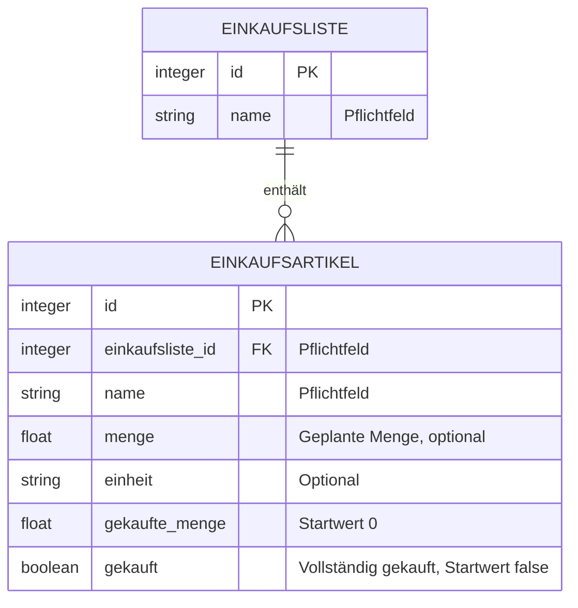

# Digitale Einkaufsliste

FHNW · Webbasierte Anwendungen · HS2026 · Projektgruppe C

Die Webanwendung verwaltet mehrere lokale Einkaufslisten. Listen und Artikel lassen sich erstellen, anzeigen, bearbeiten und löschen. Artikel können eine geplante Menge und eine Einheit haben. Beim Einkauf lässt sich ein Artikel vollständig abhaken oder in mehreren Schritten einkaufen. SQLite speichert den Stand dauerhaft. Der Sonne-/Mond-Schalter speichert die Farbauswahl im Browser.

## Installation und Start

Python 3.11 oder neuer installieren und die Befehle im Repository-Hauptordner ausführen.

**Windows (PowerShell)**

```powershell
python -m venv .venv
.\.venv\Scripts\python.exe -m pip install -r requirements.txt
.\.venv\Scripts\python.exe -m uvicorn app.main:app --reload
```

**macOS**

```bash
python3 -m venv .venv
.venv/bin/python -m pip install -r requirements.txt
.venv/bin/python -m uvicorn app.main:app --reload
```

- Die Anwendung läuft unter [http://127.0.0.1:8000/](http://127.0.0.1:8000/).
- Die interaktive API-Dokumentation ist unter [/docs](http://127.0.0.1:8000/docs) erreichbar.
- Mit `Ctrl+C` lässt sich der Server stoppen.

Die Laufzeitabhängigkeiten sind FastAPI, Uvicorn, SQLAlchemy und Pydantic. Für die Tests sind pytest und httpx in [requirements.txt](requirements.txt) aufgeführt.

Die Anwendung braucht für diese Version eine frisch angelegte `einkaufsliste.sqlite3`. Schliesse die App und verschiebe eine vorhandene Datenbankdatei vor dem ersten Start an einen sicheren Ort. Das Programm legt danach die neue Datei mit den beiden Tabellen im Repository-Hauptordner an.

## Teileinkauf demonstrieren

1. Die Liste «Migros» erstellen und «Kartoffeln» mit der geplanten Menge `3` und Einheit `kg` hinzufügen.
2. «Teileinkauf erfassen» öffnen und unter «Jetzt zusätzlich gekauft» `2` eingeben. Der Dialog zeigt vor dem Speichern «Danach offen 1 kg».
3. Speichern. Der Artikel zeigt «Teilweise gekauft», 2 von 3 kg gekauft und 1 kg offen. Er bleibt in der Liste «Migros». Die Fortschrittsanzeige zählt ihn noch als offen.
4. Erneut «Teileinkauf erfassen» wählen und `1` speichern. Die Restmenge ist 0 kg, der Artikel ist abgehakt und zählt zum Einkaufsfortschritt.
5. Die Checkbox deaktivieren, um die gekaufte Menge auf 0 zu setzen. Die Checkbox kann einen offenen oder teilweise gekauften Artikel auch direkt vollständig abhaken.
6. Einen Artikel ohne Menge hinzufügen. Seine Checkbox funktioniert weiterhin mit den Zuständen «Offen» und «Gekauft».

Der Dialog akzeptiert Punkt oder Komma als Dezimaltrennzeichen. Beim Abbrechen oder Drücken von Escape wird die Eingabe verworfen.

Über den Bleistift kannst du die geplante Menge bearbeiten. Bei einem offenen oder teilweise gekauften Mengenartikel findest du «Teileinkauf erfassen» auch im Bearbeitungsdialog. Wenn du dort Felder geändert hast, speichere zuerst die Änderungen. Die tatsächlich gekaufte Menge erfasst du anschliessend im Teileinkauf-Dialog.

Die Aktion bleibt sichtbar. Bei einem vollständig gekauften Artikel oder einem Artikel ohne gültige geplante Menge ist sie deaktiviert. Im Bearbeitungsdialog steht der Grund.

## Architektur

| Schicht | Dateien | Verantwortung |
| --- | --- | --- |
| Presentation | [HTML](app/static/index.html), [CSS](app/static/style.css), [JavaScript](app/static/app.js) | Formulare, Dialoge, Restmengenvorschau und DOM-Aktualisierung. Asynchrone JSON-Anfragen mit `fetch()` laden die Daten neu, während die Seite geöffnet bleibt. |
| Web/REST Service | [main.py](app/main.py), [services.py](app/services.py), [schemas.py](app/schemas.py) | FastAPI mit `APIRouter` und `Depends`, Pydantic für die Ein- und Ausgabeformate, Übersetzung von Geschäftsfehlern in HTTP-Antworten und OpenAPI. |
| Business Logic | [business.py](app/business.py) | Geschäftsregeln, Einkaufsstatus, Mengenberechnung und Fortschritt. Änderungen werden hier mit `session.commit()` gespeichert. |
| Persistence | [repository.py](app/repository.py), [models.py](app/models.py), [database.py](app/database.py) | SQLAlchemy-Repository, die zwei Modellklassen und ihre 1:n-Beziehung, die SQLite-Engine und die Sessions. |

Beim Teileinkauf sendet der Browser die zusätzliche Menge per `POST` an die API. Pydantic prüft das Eingabeformat. Die Business-Funktion lässt das Repository den Artikel laden, prüft die offene Restmenge und speichert die neue gekaufte Menge. Der REST-Service gibt den aktualisierten Artikel zurück. Der Browser lädt die Listendaten und zeichnet Artikelliste und Fortschritt neu.

## Datenmodell



Eine Einkaufsliste enthält null bis viele Artikel. Jeder Artikel gehört genau einer Liste. Beim Löschen einer Liste werden ihre Artikel über die ORM-Beziehung und den SQLite-Fremdschlüssel mit `ON DELETE CASCADE` entfernt. Ein Summenfeld pro Artikel reicht, um gekaufte Mengen zu erfassen. Der Boolean `gekauft` funktioniert auch bei Artikeln ohne Mengenangabe. Den dreistufigen Status, die Restmenge und den Listenfortschritt berechnet die Business-Schicht aus diesen Werten.

### Geschäftsregeln

- Namen werden getrimmt und müssen Text enthalten. Die geplante Menge ist optional. Mengen müssen endlich, positiv und auf drei relevante Nachkommastellen begrenzt sein. Nachgestellte Nullen zählen dabei nicht.
- **Neue gekaufte Menge** = bisher gekauft + jetzt zusätzlich gekauft.
- **Restmenge** = geplante Menge − gekaufte Menge. Beide Rechnungen werden mit `round(wert, 3)` gerundet. Ein Teileinkauf braucht eine geplante Menge und darf die Restmenge nicht überschreiten.
- Der Status ist «Gekauft», wenn `gekauft` wahr ist. Andernfalls ergibt eine positive gekaufte Menge «Teilweise gekauft», sonst «Offen». Der Listenfortschritt zählt nur vollständig gekaufte Artikel.
- Ein Häkchen setzt `gekauft` auf wahr und bei einem Mengenartikel die gekaufte Menge auf den Sollwert. Beim Öffnen wird die gekaufte Menge auf 0 gesetzt.
- Beim Bearbeiten bleibt die gekaufte Menge erhalten, solange der Artikel eine Mengenangabe hat. Eine neue Gesamtmenge unter der gekauften Menge oder ein Wechsel der Einheit bei schon gekaufter Menge wird abgelehnt. Bei einer Erhöhung der geplanten Menge kann ein bereits abgehakter Artikel wieder teilweise gekauft sein.
- Beim Wechsel zwischen einem vollständig gekauften Mengenartikel und einem Checkbox-Artikel ohne Menge bleibt das Häkchen erhalten. Bei einem teilweise gekauften Artikel ist das Entfernen der Menge gesperrt.

## REST-Endpunkte

| Methode | Pfad | Funktion | Erfolg |
| --- | --- | --- | --- |
| GET | `/api/listen` | Listen mit Artikeln und Fortschritt laden | 200 |
| POST | `/api/listen` | Liste erstellen, z. B. `{"name":"Migros"}` | 201 |
| GET | `/api/listen/{liste_id}` | Einzelne Liste mit Artikeln und Fortschritt laden | 200 |
| PUT | `/api/listen/{liste_id}` | Liste umbenennen | 200 |
| DELETE | `/api/listen/{liste_id}` | Liste mit ihren Artikeln löschen | 204 |
| POST | `/api/listen/{liste_id}/artikel` | Artikel mit `name`, optional `menge` und `einheit` hinzufügen | 201 |
| PATCH | `/api/artikel/{artikel_id}/status` | Checkbox-Status setzen, z. B. `{"gekauft":true}` | 200 |
| POST | `/api/artikel/{artikel_id}/teileinkauf` | Menge addieren, z. B. `{"zusaetzliche_menge":2}` | 200 |
| PUT | `/api/artikel/{artikel_id}` | Name, geplante Menge und Einheit bearbeiten | 200 |
| DELETE | `/api/artikel/{artikel_id}` | Artikel einzeln löschen | 204 |

Ein Teileinkauf gibt den aktualisierten Artikel mit `menge`, `gekaufte_menge`, `restmenge` und `status` zurück. Die Statuswerte sind `offen`, `teilweise_gekauft` und `gekauft`. Mengen erscheinen in JSON als Zahlen. Bei Artikeln ohne Mengenangabe sind die Mengenfelder `null`. Fehlende Datensätze liefern 404, ungültige Eingaben 422 mit einer Meldung in `detail`. Beim Artikel-`PUT` gelten fehlende optionale Felder als `null`.

## Tests

Im Repository-Hauptordner ausführen.

```powershell
.\.venv\Scripts\python.exe -m pytest -q
```

```bash
.venv/bin/python -m pytest -q
```

Die Tests nutzen separate SQLite-Dateien in temporären Verzeichnissen. Sie prüfen CRUD, Löschkaskade, Checkbox, Teileinkauf, Fortschritt und HTTP-Fehler.

## Reflexion und Verteidigung

Pydantic prüft das Format, der Business Layer entscheidet anhand des gespeicherten Einkaufsstands. Das macht jede Regel an einer Stelle nachvollziehbar. Mengen als `float` mit drei gerundeten Nachkommastellen reichen für übliche Einkaufsgrössen. Bei sehr grossen Zahlen sind Gleitkommazahlen begrenzt genau. Parallele Teileinkäufe am selben Artikel sind für diese lokale Anwendung ungeschützt.

Für die Verteidigung eignet sich ein Teileinkauf, bei dem ihr vom Klick bis zur SQLite-Zeile und zurück durch den Code geht. Der [Code-Guide](docs/Code-Guide.md) enthält die Klickwege, typische Prüfungsfragen und ein Glossar.

## Quellen und Hilfsmittel

- Marc Schaaf, *Projektarbeit Webbasierte Anwendungen HS2026*, insbesondere S. 3–4. [FHNW-Aufgabenstellung](docs/Projektarbeit_py.pdf)
- Projektgruppe C, Projektidee, Entwurf und Anwendung. [Projektkonzept](docs/Projektkonzept.md)
- FastAPI für Requests, Response-Modelle, Dependency Injection und Statuscodes. [FastAPI Tutorial](https://fastapi.tiangolo.com/tutorial/)
- SQLAlchemy für explizite Session-Transaktionen. [SQLAlchemy 2.0](https://docs.sqlalchemy.org/en/20/orm/session_transaction.html)
- SQLite für Fremdschlüssel und Löschkaskaden. [SQLite-Fremdschlüssel](https://www.sqlite.org/foreignkeys.html)
- MDN für asynchrone HTTP-Anfragen im Browser. [Fetch API](https://developer.mozilla.org/en-US/docs/Web/API/Fetch_API/Using_Fetch)

**KI-Deklaration.** OpenAI Codex wurde für das Grundgerüst und am 23. November 2026 für die Analyse der Schichten, die Implementierung des Teileinkaufs und die zugehörigen Tests und Dokumentation eingesetzt.

Am 23. November 2026 unterstützte OpenAI Codex das Refactoring auf `refactoring-vereinfachung`. Dazu gehörten die Vereinfachung des Datenmodells, der Mengenberechnung, der API und der Klickabläufe, das Kürzen und Ausführen der Tests, die README sowie der Code-Guide mit geprüften Zeilenverweisen. Die einzelnen Git-Commits zeigen die Änderungen. Die fachliche Prüfung und Erklärung in der Verteidigung liegen bei der Projektgruppe.
