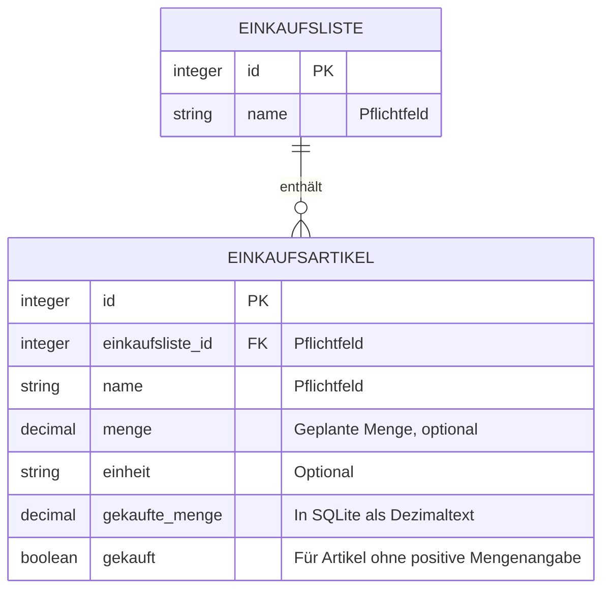

# Digitale Einkaufsliste

FHNW · Webbasierte Anwendungen · HS2026 · Projektgruppe C

Die Webanwendung verwaltet mehrere lokale Einkaufslisten. Listen und Artikel lassen sich erstellen, anzeigen, bearbeiten und löschen. Artikel können eine geplante Menge und eine Einheit haben. Beim Einkauf lässt sich ein Artikel vollständig abhaken oder in mehreren Schritten einkaufen. SQLite speichert den Stand dauerhaft.

## Installation und Start

Python 3.11 oder neuer installieren und die Befehle im Repository-Hauptordner ausführen.

**Windows (PowerShell)**

```powershell
python -m venv .venv
.\.venv\Scripts\python.exe -m pip install -r requirements.txt
.\.venv\Scripts\python.exe -m uvicorn app.main:app --reload
```

**macOS**

```bash
python3 -m venv .venv
.venv/bin/python -m pip install -r requirements.txt
.venv/bin/python -m uvicorn app.main:app --reload
```

- Die Anwendung läuft unter [http://127.0.0.1:8000/](http://127.0.0.1:8000/).
- Die interaktive API-Dokumentation ist unter [/docs](http://127.0.0.1:8000/docs) erreichbar.
- Mit `Ctrl+C` lässt sich der Server stoppen.

Die Laufzeitabhängigkeiten sind FastAPI, Uvicorn, SQLAlchemy und Pydantic. Für die Tests sind pytest und httpx in [requirements.txt](requirements.txt) aufgeführt.

## Teileinkauf demonstrieren

1. Die Liste «Migros» erstellen und «Kartoffeln» mit der geplanten Menge `3` und Einheit `kg` hinzufügen.
2. «Teileinkauf erfassen» öffnen und unter «Jetzt zusätzlich gekauft» `2` eingeben. Der Dialog zeigt vor dem Speichern «Danach offen 1 kg».
3. Speichern. Der Artikel zeigt «Teilweise gekauft», 2 von 3 kg gekauft und 1 kg offen. Er bleibt in der Liste «Migros». Die Fortschrittsanzeige zählt ihn noch als offen.
4. Erneut «Teileinkauf erfassen» wählen und `1` speichern. Die Restmenge ist 0 kg, der Artikel ist abgehakt und zählt zum Einkaufsfortschritt.
5. Die Checkbox deaktivieren, um die gekaufte Menge auf 0 zu setzen. Die Checkbox kann einen offenen oder teilweise gekauften Artikel auch direkt vollständig abhaken.
6. Einen Artikel ohne Menge hinzufügen. Seine Checkbox funktioniert weiterhin mit den Zuständen «Offen» und «Gekauft».

Der Dialog akzeptiert Punkt oder Komma als Dezimaltrennzeichen. Beim Abbrechen oder Drücken von Escape wird die Eingabe verworfen.

Über den Bleistift kannst du die geplante Menge bearbeiten. Bei einem offenen oder teilweise gekauften Mengenartikel findest du «Teileinkauf erfassen» auch im Bearbeitungsdialog. Wenn du dort Felder geändert hast, speichere zuerst die Änderungen. Die tatsächlich gekaufte Menge erfasst du anschliessend im Teileinkauf-Dialog.

Die Aktion bleibt sichtbar. Bei einem vollständig gekauften Artikel oder einem Artikel ohne gültige geplante Menge ist sie deaktiviert. Im Bearbeitungsdialog steht der Grund.

Mit «Gekaufte Menge korrigieren» ersetzt du einen bereits erfassten Wert. Bei einem teilweise gekauften Artikel erscheint die Schaltfläche direkt in der Artikelzeile. Bei einem vollständig gekauften Mengenartikel findest du sie über den Bleistift. Wenn du von geplanten 3 kg statt 2 kg tatsächlich 1,5 kg gekauft hast, gibst du als neue gekaufte Gesamtmenge `1,5` ein. Danach sind 1,5 kg offen. Mit `0` setzt du den Artikel wieder auf offen.

## Architektur

| Schicht | Dateien | Verantwortung |
| --- | --- | --- |
| Presentation | [HTML](app/static/index.html), [CSS](app/static/style.css), [JavaScript](app/static/app.js) | Formulare, Dialoge, Restmengenvorschau und DOM-Aktualisierung. Asynchrone JSON-Anfragen mit `fetch()` laden die Daten neu, während die Seite geöffnet bleibt. |
| Web/REST Service | [main.py](app/main.py), [services.py](app/services.py), [schemas.py](app/schemas.py) | FastAPI mit `APIRouter` und `Depends`, Pydantic für Ein- und Ausgaben, Übersetzung von Geschäftsfehlern in HTTP-Antworten und OpenAPI. |
| Business Logic | [business.py](app/business.py) | Validierung, Einkaufsstatus, Mengenberechnung, Fortschritt und Transaktionsgrenzen. Datenaustausch mit Python-Typen und Domänenfehlern als Python-Exceptions. |
| Persistence | [repository.py](app/repository.py), [models.py](app/models.py), [database.py](app/database.py) | SQLAlchemy-Repository, Modellklassen mit `DeclarativeBase`, `Mapped` und `mapped_column`, die 1:n-Beziehung, SQLite-Engine, Sessions und Startmigration. |

Beim Teileinkauf sendet der Browser die zusätzliche Menge per `POST` an das API. Pydantic prüft das Eingabeformat. Die Business-Funktion startet eine Transaktion, lässt das Repository den Artikel laden, prüft die offene Restmenge und speichert die neue gekaufte Menge. Der REST-Service gibt den aktualisierten Artikel zurück. Der Browser lädt die Listendaten und zeichnet Artikelliste und Fortschritt neu.

## Datenmodell



Eine Einkaufsliste enthält null bis viele Artikel. Jeder Artikel gehört genau einer Liste. Beim Löschen einer Liste werden ihre Artikel über die ORM-Beziehung und den SQLite-Fremdschlüssel mit `ON DELETE CASCADE` entfernt. Status, Restmenge und Listenfortschritt werden aus den gespeicherten Werten berechnet.

### Geschäftsregeln

- Namen werden getrimmt und müssen Text enthalten. Die geplante Menge ist optional. Mengen müssen endlich, positiv und auf drei relevante Nachkommastellen begrenzt sein. Nachgestellte Nullen zählen dabei nicht.
- **Neue gekaufte Menge** = bisher gekauft + jetzt zusätzlich gekauft.
- **Restmenge** = geplante Menge − neue gekaufte Menge. Eine Eingabe über der offenen Restmenge wird abgelehnt.
- Mengenartikel sind bei 0 gekaufter Menge offen, bei einer Menge zwischen 0 und der Gesamtmenge teilweise gekauft und bei Erreichen der Gesamtmenge gekauft. Der Listenfortschritt zählt nur vollständig gekaufte Artikel.
- Beim Abhaken setzt der Business Layer die gekaufte Menge auf die Gesamtmenge. Beim Öffnen setzt er sie auf 0. Für Artikel ohne positive Menge verwendet er den vorhandenen Boolean.
- Beim Bearbeiten bleibt die gekaufte Menge erhalten, solange der Artikel eine Mengenangabe hat. Eine neue Gesamtmenge unter der gekauften Menge oder ein Wechsel der Einheit bei schon gekaufter Menge wird abgelehnt. Bei einer Erhöhung der geplanten Menge kann ein bereits abgehakter Artikel wieder teilweise gekauft sein.
- Beim Wechsel zwischen einem vollständig gekauften Mengenartikel und einem Checkbox-Artikel ohne Menge bleibt das Häkchen erhalten. Bei einem teilweise gekauften Artikel ist das Entfernen der Menge gesperrt.
- Positive Altwerte mit mehr als drei Nachkommastellen bleiben gespeichert. Die Checkbox funktioniert auch für diese Artikel. Für Teileinkäufe muss die geplante Menge zuerst auf eine gültige Genauigkeit geändert werden. Beim Bearbeiten des Namens oder anderer Felder bleibt eine unveränderte Mengenangabe erhalten.

### SQLite und Migration

Die Anwendung verwendet `einkaufsliste.sqlite3` im Repository-Hauptordner. Beim Start legt sie fehlende Tabellen an. Hat eine vorhandene Artikeltabelle noch keine Spalte `gekaufte_menge`, ergänzt sie diese mit Standardwert 0. Bei positiv geplanten und bereits abgehakten Artikeln übernimmt sie die geplante Menge als gekaufte Menge. Für Artikel ohne positive Menge bleibt der bisherige Boolean massgeblich. Die Migration läuft in einer Transaktion. Sobald die Spalte vorhanden ist, überspringen weitere Starts die Migration.

Die vorhandene geplante Menge behält die SQLite-Affinität `NUMERIC`. Neue geplante Werte müssen sich dort ohne Änderung des Dezimalwerts speichern lassen. Die gekaufte Menge wird als Dezimaltext gespeichert und serverseitig mit `Decimal` verarbeitet. `BEGIN IMMEDIATE` reserviert den SQLite-Schreibzugriff vor dem Lesen eines Artikels, damit parallele Änderungen auf dem jeweils zuletzt gespeicherten Stand aufbauen. `session.begin()` schliesst die Transaktion im Business Layer ab oder rollt sie bei einem Fehler zurück.

## REST-Endpunkte

| Methode | Pfad | Funktion | Erfolg |
| --- | --- | --- | --- |
| GET | `/api/listen` | Listen mit Artikeln und Fortschritt laden | 200 |
| POST | `/api/listen` | Liste erstellen, z. B. `{"name":"Migros"}` | 201 |
| GET | `/api/listen/{liste_id}` | Einzelne Liste mit Artikeln und Fortschritt laden | 200 |
| PUT | `/api/listen/{liste_id}` | Liste umbenennen | 200 |
| DELETE | `/api/listen/{liste_id}` | Liste mit ihren Artikeln löschen | 204 |
| POST | `/api/listen/{liste_id}/artikel` | Artikel mit `name`, optional `menge` und `einheit` hinzufügen | 201 |
| PATCH | `/api/artikel/{artikel_id}/status` | Checkbox-Status setzen, z. B. `{"gekauft":true}` | 200 |
| POST | `/api/artikel/{artikel_id}/teileinkauf` | Menge addieren, z. B. `{"zusaetzliche_menge":"2"}` | 200 |
| PATCH | `/api/artikel/{artikel_id}/gekaufte-menge` | Gekaufte Menge ersetzen, z. B. `{"gekaufte_menge":"1.5"}` | 200 |
| PUT | `/api/artikel/{artikel_id}` | Name, geplante Menge und Einheit bearbeiten | 200 |
| DELETE | `/api/artikel/{artikel_id}` | Artikel einzeln löschen | 204 |

Ein Teileinkauf gibt den aktualisierten Artikel mit `menge`, `gekaufte_menge`, `restmenge`, `status` und dem kompatiblen Boolean `gekauft` zurück. Die Statuswerte sind `offen`, `teilweise_gekauft` und `gekauft`. Dezimalmengen stehen in JSON als Strings. `gekaufte_menge` und `restmenge` sind bei Artikeln ohne positive Menge `null`. Fehlende Datensätze liefern 404, ungültige Eingaben 422 mit einer Meldung in `detail`. Beim Artikel-`PUT` gelten fehlende optionale Felder als `null`.

## Tests

Im Repository-Hauptordner ausführen.

```powershell
.\.venv\Scripts\python.exe -m pytest -q
```

```bash
.venv/bin/python -m pytest -q
```

Die Tests nutzen separate SQLite-Dateien in temporären Verzeichnissen. Sie prüfen CRUD, Validierung, beide Einkaufsarten, Fortschritt, Dezimalgenauigkeit, parallele Teileinkäufe, Altbestandsmigration und den Rollback nach einem SQL-Fehler.

## Reflexion und Verteidigung

Die Auswertung der gekauften Menge hält den Status eines Mengenartikels konsistent. Ein Boolean deckt den Sonderfall ohne Menge ab. Das Speichern eines Summenfelds reicht für die gewünschte Funktion aus und hält das Modell bei zwei Entitäten. Die Transaktionsgrenze gehört zum Geschäftsvorgang, weil Laden, Prüfen und Speichern gemeinsam gelingen müssen. Die Vorschau arbeitet fürs direkte Feedback mit ganzen Tausendsteln. Die verbindliche Prüfung und Berechnung findet mit `Decimal` auf dem Server statt.

Für die Verteidigung eignen sich der Weg eines Teileinkaufs durch alle vier Schichten, der Unterschied zwischen Mengenstatus und Checkbox ohne Menge, die Übernahme abgehakter Altartikel und der Rollback-Test.

## Quellen und Hilfsmittel

- Marc Schaaf, *Projektarbeit Webbasierte Anwendungen HS2026*, insbesondere S. 3–4. [FHNW-Aufgabenstellung](docs/Projektarbeit_py.pdf)
- Projektgruppe C, Projektidee, Entwurf und Anwendung. [Projektkonzept](docs/Projektkonzept.md)
- FastAPI für Requests, Response-Modelle, Dependency Injection und Statuscodes. [FastAPI Tutorial](https://fastapi.tiangolo.com/tutorial/)
- SQLAlchemy für explizite Session-Transaktionen. [SQLAlchemy 2.0](https://docs.sqlalchemy.org/en/20/orm/session_transaction.html)
- SQLite für Typaffinitäten und Transaktionen. [SQLite-Datentypen](https://www.sqlite.org/datatype3.html) · [SQLite-Transaktionen](https://www.sqlite.org/lang_transaction.html)
- Python für dezimale Arithmetik. [`decimal`-Dokumentation](https://docs.python.org/3/library/decimal.html)
- MDN für asynchrone HTTP-Anfragen im Browser. [Fetch API](https://developer.mozilla.org/en-US/docs/Web/API/Fetch_API/Using_Fetch)

**KI-Deklaration.** Die vorherige README weist OpenAI Codex bereits als Hilfsmittel für das Grundgerüst aus. Am 23. November 2026 wurde Codex mit dem Auftrag «FHNW-Projekt ‹Digitale Einkaufsliste› überarbeiten und erweitern» erneut eingesetzt. Die Unterstützung umfasste die Analyse der Schichten und des Quellcodes, die Implementierung des Teileinkaufs und der SQLite-Migration, die Ergänzung und Ausführung automatisierter Tests sowie die Aktualisierung der Dokumentation. Der Chat-Auftrag und der Git-Diff dokumentieren den Umfang dieser Überarbeitung. Die fachliche Prüfung und Erklärung in der Projektverteidigung liegen bei der Projektgruppe.
